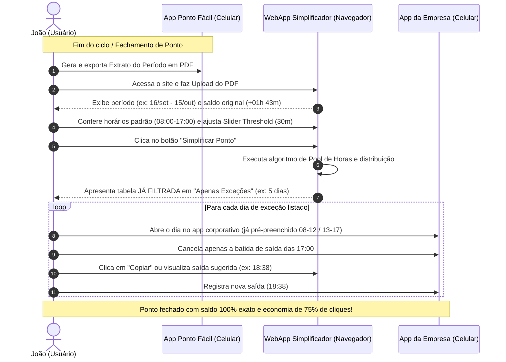
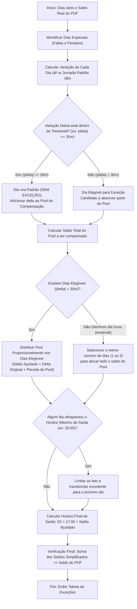

# Especificação Técnica e Funcional: WebApp Simplificador de Ponto por Exceção

## 1. Visão Geral e Contexto de Negócio

### 1.1 O Problema
Em muitas empresas, o registro de jornada adota o modelo de **Ponto por Exceção** (previsto no art. 74, § 4º da CLT). Nesse modelo:
1. O sistema corporativo de ponto **já preenche automaticamente** todos os dias úteis com os horários contratuais padrão (exemplo: `08:00 - 12:00` e `13:00 - 17:00`, totalizando 8 horas diárias).
2. O colaborador **só precisa registrar exceções** caso seu dia tenha divergido do padrão contratual.
3. No entanto, quem utiliza aplicativos pessoais de controle diário de ponto (como o aplicativo móvel **Ponto Fácil**) registra batidas reais com pequenas variações diárias (ex: sair 7 minutos depois em um dia, 12 minutos antes no outro, 15 minutos a mais no almoço, etc.).
4. Para refletir fielmente o saldo do banco de horas no sistema da empresa, o colaborador é atualmente forçado a **cancelar todas as 4 batidas pré-preenchidas** de quase todos os dias e lançar manualmente cada uma das batidas reais, gerando centenas de cliques repetitivos e desperdício de tempo mensal.

### 1.2 A Solução
O **Simplificador de Ponto** é uma aplicação web estática (SPA client-side, 100% no navegador) projetada para:
1. **Importar o PDF** do extrato mensal gerado pelo app *Ponto Fácil*.
2. **Extrair com precisão** todas as batidas reais, ocorrências (faltas, feriados) e o saldo consolidado do período.
3. **Aplicar um algoritmo inteligente de simplificação baseado em Pool de Horas e Threshold**:
   - Variações pequenas (dentro de uma tolerância configurável, ex: $\pm 30$ minutos) são absorvidas pelo padrão da empresa (dia sem alteração).
   - O resíduo acumulado dessas pequenas variações é alocado nos dias que **já ultrapassaram o threshold** (onde o usuário obrigatoriamente já teria que dar entrada).
   - Caso nenhum dia tenha ultrapassado o threshold, o saldo residual total é concentrado no **menor número possível de dias** (idealmente 1 único dia).
   - O saldo final do período no sistema corporativo bate **100% exatamente** com o saldo do extrato original.
4. **Minimizar as alterações por dia**: Em vez de substituir 4 batidas, a ferramenta instrui o usuário a **alterar apenas a última batida de saída (S2)**, mantendo a entrada e o almoço padrão intocados.
5. **Facilitar o preenchimento**: Interface visual interativa com sliders de ajuste em tempo real, filtros rápidos ("Apenas Exceções") e botões de cópia com 1 clique para agilizar a colagem no portal da empresa.

### 1.3 Princípios de Design e Privacidade
- **Privacidade Total (Zero Backend)**: Todo o processamento (leitura de PDF, cálculos e renderização) ocorre exclusivamente no navegador do usuário via JavaScript. Nenhum dado de ponto, horário ou documento é enviado para servidores externos.
- **Portabilidade**: Aplicação estática pura, executável localmente com duplo clique ou hospedável em serviços estáticos gratuitos (GitHub Pages, Cloudflare Pages, Vercel, Netlify).
- **Fidelidade Matemática**: A soma dos saldos simplificados deve ser estritamente igual ao saldo total do período do PDF.

---

## 2. Persona, Jornada do Usuário e Histórias de Usuário (User Stories)

### 2.1 Persona: João, o Colaborador em Ponto por Exceção
- **Perfil**: João, 29 anos, analista/desenvolvedor sob contrato de 40h semanais (8h diárias).
- **Ambiente de Trabalho**: A empresa adota o modelo de ponto por exceção. O sistema/aplicativo corporativo pré-preenche automaticamente os dias úteis com o horário padrão (`08:00 - 12:00` e `13:00 - 17:00`).
- **Hábito**: Para controlar sua rotina pessoal, João bate o ponto no smartphone pelo aplicativo **Ponto Fácil** toda vez que inicia o trabalho, sai para o almoço, volta e encerra o dia.
- **Dor**: No fechamento mensal solicitado pelo RH, João precisa entrar no app da empresa e registrar as diferenças para que o banco de horas bata. Hoje, ele é forçado a apagar as batidas prévias de cada dia e lançar manualmente cada batida real, gerando dezenas de cliques e frustração.
- **Objetivo**: Subir o extrato do Ponto Fácil no webapp simplificador, filtrar apenas os dias estritamente necessários e, em cada um desses dias, **cancelar apenas a última batida padrão e lançar a saída sugerida**, batendo o saldo do período com esforço mínimo.

---

### 2.2 Jornada do Usuário (User Journey de Ponta a Ponta)



---

### 2.3 Histórias de Usuário (Formato Ágil & Critérios BDD / Gherkin)

#### **US-01: Importação e Leitura Transparente do PDF**
> **Como** João,  
> **Quero** arrastar ou selecionar o PDF gerado pelo Ponto Fácil no site,  
> **Para que** o sistema extraia automaticamente todas as minhas batidas, dias trabalhados e o saldo total do período sem que eu precise digitar nada manualmente.

- **Critério de Aceite 1.1 (Processamento Local)**: O processamento do PDF deve ocorrer 100% no navegador do usuário via `pdf.js`, sem envio de dados para servidores.
- **Critério de Aceite 1.2 (Feedback Imediato)**: Após o upload, a tela deve exibir imediatamente o período identificado (ex: `16 set. 2026 - 15 out. 2026`), a quantidade de dias úteis e o saldo total do período.
- **Cenário BDD**:
  ```gherkin
  Dado que João exportou o extrato "16 set. 2026 - 15 out. 2026.pdf" do Ponto Fácil
  Quando ele arrasta o arquivo para a área de upload do Simplificador
  Então o sistema deve ler o arquivo com sucesso
  E exibir o resumo: Período "16/09/2026 a 15/10/2026" e Saldo do Período "+01h 43m".
  ```

---

#### **US-02: Configuração de Parâmetros e Sliders Interativos**
> **Como** João,  
> **Quero** configurar minha jornada diária (8h), meus horários padrão pré-preenchidos (08:00-12:00 / 13:00-17:00) e os sliders de threshold e saída máxima,  
> **Para que** o algoritmo adapte os cálculos à realidade do sistema da minha empresa e aos meus limites de horário.

- **Critério de Aceite 2.1 (Valores Padrão)**: A aplicação deve vir pré-configurada por padrão com:
  - Jornada diária: `08:00`
  - Horários padrão: Entrada 1 (`08:00`), Saída 1 (`12:00`), Entrada 2 (`13:00`), Saída 2 (`17:00`)
  - Slider de Threshold de tolerância: `30 minutos`
  - Slider de Saída Máxima: `20:00`
- **Critério de Aceite 2.2 (Reatividade)**: Alterar qualquer slider ou horário deve atualizar os cálculos da tela de forma reativa e instantânea.
- **Cenário BDD**:
  ```gherkin
  Dado que João carregou o extrato no sistema
  Quando ele ajusta o slider de threshold de 30 minutos para 45 minutos
  Então o sistema recalcula o pool de horas imediatamente
  E reduz a quantidade de dias com exceção necessária na tela.
  ```

---

#### **US-03: Botão de Simplificação e Visualização Focada em Exceções**
> **Como** João,  
> **Quero** clicar no botão "Simplificar Ponto" e receber a tabela filtrada automaticamente exibindo **apenas os dias que exigem alteração**,  
> **Para que** eu não perca tempo visualizando dias normais e foque diretamente nas ações que devo executar.

- **Critério de Aceite 3.1 (Filtro Padrão Automático)**: Ao concluir a simplificação, o filtro ativo da tabela deve ser por padrão **"Apenas Exceções"**.
- **Critério de Aceite 3.2 (Métricas Visuais)**: A tela deve exibir cards comparativos destacando:
  - Quantidade original de dias com desvio vs. Quantidade simplificada de exceções (ex: "De 18 dias com diferença para apenas 5 exceções").
  - Saldo Total do Período preservado (100% idêntico ao PDF original).
- **Cenário BDD**:
  ```gherkin
  Dado que o PDF foi processado e os parâmetros foram definidos
  Quando João clica no botão "Simplificar Ponto"
  Então a tabela exibe apenas os dias que necessitam de intervenção
  E exibe um botão alternador que permite ao usuário ver "Todas as datas" caso deseje conferir.
  ```

---

#### **US-04: Instrução Clara de Alteração de Batida Única (Cancelar e Incluir Saída)**
> **Como** João, com o app corporativo aberto no smartphone,  
> **Quero** ver com clareza para cada dia qual batida padrão cancelar e qual horário final de saída registrar,  
> **Para que** eu não precise reconstruir as 4 batidas do dia no app corporativo.

- **Critério de Aceite 4.1 (Identificação de Ação)**: Cada linha da tabela de exceções deve indicar explicitamente:
  - Data do dia (ex: `qui., 17 set. 2026`).
  - Saldo ajustado atribuído ao dia (ex: `-42m`).
  - Orientação: "No app da empresa: Cancele a batida das 17:00 e lance saída às 16:18".
- **Critério de Aceite 4.2 (Casos Especiais)**: Dias com falta sem abono de dia inteiro devem ser sinalizados com a instrução: "Lançar como Falta / Remover batidas".
- **Cenário BDD**:
  ```gherkin
  Dado que o dia 17/set foi selecionado como dia de exceção com saída calculada para 16:18
  Quando João consulta a linha do dia 17/set na tabela
  Então ele visualiza a instrução de manter Entrada 1 (08:00), Almoço (12:00-13:00), cancelar a saída das 17:00 e lançar 16:18.
  ```

---

#### **US-05: Cópia Ágil de Horários para o Clipboard**
> **Como** João,  
> **Quero** clicar em um botão de cópia ao lado de cada horário sugerido,  
> **Para que** eu possa colar ou conferir o horário com agilidade sem risco de erro de digitação.

- **Critério de Aceite 5.1 (Ação de 1 Clique)**: Cada dia com exceção deve possuir um botão com ícone de cópia (`[📋]`).
- **Critério de Aceite 5.2 (Feedback Visual)**: Ao clicar, o sistema deve copiar o horário (ex: `16:18`) para a área de transferência do sistema operacional e mostrar feedback ("Copiado!").

---

## 3. Stack Tecnológica e Arquitetura

### 3.1 Tecnologias Escolhidas
| Componente | Tecnologia | Justificativa |
|---|---|---|
| **Linguagem Base** | HTML5 + JavaScript Moderno (ES6+ Modules) | Dispensa compiladores, bundlers ou `npm install`. Roda nativamente em qualquer navegador moderno. |
| **Estilização** | TailwindCSS (via CDN oficial) | Produtividade na construção de UI limpa, responsiva, moderna e com suporte a Dark/Light mode. |
| **Parser de PDF** | Mozilla `pdf.js` (via CDN cdnjs / unpkg) | Padrão da indústria para renderização e extração de texto de PDFs no client-side sem backend. |
| **Ícones** | Lucide Icons (Vanilla script) | Ícones SVG leves, consistentes e modernos. |

### 3.2 Estrutura de Arquivos da Aplicação
```text
simplificador-de-ponto/
├── index.html              # Estrutura HTML da página única e UI
├── css/
│   └── styles.css          # Estilos complementares / animações sutis
├── js/
│   ├── app.js              # Ponto de entrada, binding de eventos e estado reativo
│   ├── parser.js           # Extração e normalização de texto do PDF (pdf.js)
│   ├── optimizer.js        # Algoritmo de simplificação (Pool de Horas & Threshold)
│   └── ui.js               # Renderização de tabela, métricas, sliders e clipboard
└── data/
    └── 16 set. 2026 - 15 out. 2026.pdf # Amostra real para validação e testes
```

---

## 4. Engenharia de Extração do PDF (Ponto Fácil v4.x)

### 4.1 Estrutura do Documento Gerado pelo Ponto Fácil
Com base na análise do extrato real gerado pelo Ponto Fácil (v4.0.28):
- **Cabeçalho**:
  - Linha identificadora: `Gerado por Ponto Fácil (v4.0.28) em DD/MM/AAAA HH:mm`
  - Período: `Extrato\n DD/mmm./AAAA - DD/mmm./AAAA`
- **Tabela Mensal**:
  - Cabeçalho de colunas: `Data`, `Entrada`, `Saída`, `Saldo do dia`, `Saldo do período`, `Banco de horas`
  - Formato de Data: `ddd., DD mmm. AAAA` (ex: `qua., 16 set. 2026`, `ter., 22 set. 2026`)
  - Batidas: Sequência alternada de horários no formato `HH:mm`. Pode conter 2, 4 ou até 6 batidas em dias com jornadas fracionadas ou trabalho noturno.
  - Eventos especiais de texto:
    - `Falta sem abono / dia todo`
    - `Falta abonada / dia todo`
    - `Feriado` / `Feriado com abono`
    - `Nenhum ponto registrado!`
  - Bloco de Resumo Diário:
    ```text
    Resumo:
    [sinal] HHh MMm   (Saldo do dia)
    [sinal] HHh MMm   (Saldo do período acumulado)
    [sinal] HHh MMm   (Banco de horas geral)
    ```

### 4.2 Gramática de Expressões Regulares (Regex) do Parser
O módulo `parser.js` utiliza uma máquina de estados simples sobre o fluxo de linhas extraído pelo `pdf.js`:

```javascript
// Padrões de captura:
const PATTERNS = {
  dateHeader: /^([a-z]{3}\.,\s+\d{1,2}\s+[a-z]{3}\.\s+\d{4})/i,
  timePunch: /^([01]\d|2[0-3]):([0-5]\d)$/,
  balanceLine: /^([+-])\s*(\d{2})h\s*(\d{2})m$/,
  specialEvent: /(falta sem abono|falta abonada|feriado|nenhum ponto registrado)/i,
  periodRange: /(\d{1,2}\/[a-z]{3}\.\/\d{4})\s*-\s*(\d{1,2}\/[a-z]{3}\.\/\d{4})/i
};
```

### 4.3 Modelo de Dados Estruturado (TypeScript Interface Conceitual)
```typescript
interface PunchRecord {
  type: 'entrada' | 'saida';
  time: string; // "09:10"
  minutesFromMidnight: number; // 550
}

interface ParsedDay {
  dateStr: string;           // "qua., 16 set. 2026"
  dateISO: string;           // "2026-09-16"
  dayOfWeek: string;         // "qua."
  punches: PunchRecord[];    // Lista de batidas reais do PDF
  originalBalanceMinutes: number; // +7 (convertido de "+ 00h 07m")
  isSpecial: boolean;        // true se for falta/feriado
  specialReason?: string;    // "Falta sem abono / dia todo"
}

interface PeriodData {
  startDate: string;
  endDate: string;
  days: ParsedDay[];
  totalOriginalBalanceMinutes: number; // Saldo real acumulado do período
}
```

---

## 5. Regras de Negócio e Algoritmo de Otimização

### 5.1 Conceito Central: Algoritmo de Pool de Horas e Threshold



### 5.2 Parâmetros Configuráveis pelo Usuário (Painel da Interface)
1. **Jornada Contratual Diária**: Padrão de 8 horas (`480 minutos`).
2. **Horários Pré-preenchidos pela Empresa**:
   - `Entrada 1`: `08:00`
   - `Saída 1 (Almoço)`: `12:00`
   - `Entrada 2 (Retorno)`: `13:00`
   - `Saída 2 Padrão`: `17:00` (calculada automaticamente a partir da jornada).
3. **Slider de Threshold de Tolerância**:
   - Intervalo: `0 a 60 minutos` (passo de 5 min).
   - **Padrão**: `30 minutos`.
   - Dias com saldo diário entre `-Threshold` e `+Threshold` são preservados como padrão (zero exceções).
4. **Slider de Horário Máximo de Saída (Teto Noturno)**:
   - Intervalo: `17:30 a 22:00` (passo de 15 min).
   - **Padrão**: `20:00` (evita jornadas que fiquem fora de um horário de expediente aceitável ou que violem a restrição legal de no máximo 2 horas extras diárias).

### 5.3 Pseudocódigo Detalhado do Algoritmo

```javascript
function optimizePunches(days, config) {
  const { thresholdMinutes, maxExitTime, standardSchedule } = config;
  // standardSchedule: { e1: "08:00", s1: "12:00", e2: "13:00", s2: "17:00", dailyMinutes: 480 }
  
  // 1. Separar dias especiais e dias úteis trabalhados
  const workDays = [];
  const specialDays = [];
  
  for (const day of days) {
    if (day.isSpecial) {
      specialDays.push(day);
    } else {
      workDays.push({ ...day, simplifiedAction: 'none', adjustedBalance: 0 });
    }
  }

  // 2. Classificar dias entre elegíveis (que furam o threshold) e absorvidos (dentro do threshold)
  let poolMinutes = 0;
  const eligibleDays = [];
  const absorbedDays = [];

  for (const day of workDays) {
    const delta = day.originalBalanceMinutes;
    if (Math.abs(delta) <= thresholdMinutes) {
      // Dia absorvido: no sistema da empresa fica o padrão contratual (saldo 0)
      absorbedDays.push(day);
      poolMinutes += delta; // O delta precisa ser compensado em outro lugar
      day.simplifiedAction = 'keep_standard';
      day.adjustedBalance = 0;
    } else {
      // Dia que já fura o threshold: obrigatoriamente terá exceção
      eligibleDays.push(day);
    }
  }

  // 3. Distribuição do Pool de Minutos
  if (eligibleDays.length > 0) {
    // Distribuir o pool proporcionalmente ou igualmente entre os dias elegíveis
    // Parcela base por dia elegível
    let remainingPool = poolMinutes;
    const count = eligibleDays.length;
    const deltaPerDay = Math.trunc(remainingPool / count);
    let remainder = remainingPool % count;

    for (const day of eligibleDays) {
      let allocatedDelta = deltaPerDay;
      if (remainder !== 0) {
        const sign = remainder > 0 ? 1 : -1;
        allocatedDelta += sign;
        remainder -= sign;
      }
      
      // Saldo ajustado do dia = Variação original daquele dia + cota do pool
      let targetBalance = day.originalBalanceMinutes + allocatedDelta;

      // 4. Checar teto de horário máximo de saída
      // S2 padrão (ex: 17:00 = 1020 min) + targetBalance
      const maxExitMinutes = parseTimeToMinutes(maxExitTime);
      const standardS2Minutes = parseTimeToMinutes(standardSchedule.s2);
      const maxAllowedBalance = maxExitMinutes - standardS2Minutes; // ex: 20:00 - 17:00 = +180 min

      if (targetBalance > maxAllowedBalance) {
        const overflow = targetBalance - maxAllowedBalance;
        targetBalance = maxAllowedBalance;
        remainder += overflow; // Devolve o excesso para o pool a ser redistribuído
      }

      day.adjustedBalance = targetBalance;
      day.simplifiedAction = 'modify_exit';
    }

    // Se sobrou algum resíduo de overflow, distribui nos dias elegíveis com folga
    if (remainder !== 0) {
      distributeResidualSafely(eligibleDays, remainder, maxAllowedBalance);
    }
  } else {
    // 5. Caso especial: Nenhum dia furou o threshold, mas o pool != 0
    if (poolMinutes !== 0 && workDays.length > 0) {
      // Escolher o melhor dia (ex: dia com maior folga ou último dia útil)
      allocatePoolToMinimumDays(workDays, poolMinutes, maxExitTime, standardSchedule);
    }
  }

  // 6. Calcular a batida S2 exata para cada dia de exceção
  for (const day of workDays) {
    if (day.simplifiedAction === 'modify_exit') {
      const s2Base = parseTimeToMinutes(standardSchedule.s2);
      const adjustedS2Minutes = s2Base + day.adjustedBalance;
      day.suggestedPunchS2 = formatMinutesToTime(adjustedS2Minutes);
      day.reason = `Ajustar Saída 2 para ${day.suggestedPunchS2} (Saldo: ${formatDelta(day.adjustedBalance)})`;
    }
  }

  return { workDays, specialDays };
}
```

### 5.4 Regra de Ouro da Batida Ajustada
Para qualquer dia que necessite de exceção, a aplicação instrui:
- **E1 (Entrada)**: Manter o padrão da empresa (`08:00`)
- **S1 (Saída Almoço)**: Manter o padrão da empresa (`12:00`)
- **E2 (Retorno Almoço)**: Manter o padrão da empresa (`13:00`)
- **S2 (Saída Final)**: **Alterar apenas este horário** para `17:00 + Saldo Ajustado`.

*Exemplo Prático*:
- Se o saldo ajustado do dia for `+46 minutos`: S2 torna-se `17:46`.
- Se o saldo ajustado do dia for `-30 minutos`: S2 torna-se `16:30`.
- O colaborador clica no botão "Copiar Horário" e simplesmente atualiza um único campo no sistema da empresa!

### 5.5 Tratamento de Dias Especiais
- **Feriados e Folgas**: Feriados nacionais (ex: 12 de outubro - N. Sra Aparecida) que constam no extrato como "Nenhum ponto registrado!" ou "Feriado abonado" **não geram exceção**, pois a empresa já considera o dia sem expediente.
- **Faltas sem abono / dia todo**:
  - São mantidas isoladas com alerta vermelho no app.
  - Ação sugerida: "Lançar como Falta Integral" ou "Remover todas as batidas do dia".
  - Não participam da distribuição do pool de horas trabalhadas ordinárias para evitar distorções graves de jornada.

---

## 6. Especificação de Interface do Usuário (UI/UX)

### 6.1 Visão Geral do Layout
A interface é dividida em 4 blocos visuais limpos e intuitivos:

```text
+--------------------------------------------------------------------------+
|  LOGO & TÍTULO: Simplificador de Ponto por Exceção                       |
|  [ Botão / Área de Arrastar e Soltar PDF do Ponto Fácil ]               |
+--------------------------------------------------------------------------+
|  PAINEL DE CONTROLE & SLIDERS (Interativo em Tempo Real)                 |
|  - Jornada Diária: [ 08:00 ]        - Horário Padrão: 08:00 - 17:00       |
|  - Slider de Threshold: [====O====] 30 minutos                           |
|  - Slider de Saída Máxima: [=======O==] 20:00                            |
+--------------------------------------------------------------------------+
|  CARDS DE RESUMO & IMPACTO                                               |
|  [ Saldo Total: +01h 43m ]  [ Dias Úteis: 22 ]                           |
|  [ Exceções Originais: 18 ] [ Exceções Simplificadas: 5 ] (-72% Cliques) |
+--------------------------------------------------------------------------+
|  BARRA DE FILTROS:  (•) Apenas Exceções (5)  ( ) Todas as Datas (22)     |
+--------------------------------------------------------------------------+
|  TABELA DE LANÇAMENTO                                                    |
|  Data        | Real PDF    | Ação Sugerida        | Batida Final | Copiar|
|  qua, 16 set | +00h 07m    | Manter Padrão        | 17:00        | -     |
|  qui, 17 set | -00h 54m    | Alterar Saída (-42m) | 16:18        | [📋]  |
|  seg, 21 set | +02h 31m    | Alterar Saída (+2h38)| 19:38        | [📋]  |
|  ...         | ...         | ...                  | ...          | ...   |
+--------------------------------------------------------------------------+
```

### 6.2 Estados da Interface
1. **Estado Inicial (Sem arquivo)**:
   - Área central de drop de arquivo destacada em pontilhado com ícone de upload.
   - Mensagem: "Arraste o extrato em PDF do Ponto Fácil ou clique para selecionar".
   - Aviso de privacidade: "Processamento 100% no seu navegador. Nenhum dado sai do seu computador."
2. **Estado Carregado / Resultado Ativo**:
   - Os sliders tornam-se reativos: mexer no slider de threshold (ex: de 15m para 30m ou 45m) recalcula instantaneamente toda a tabela e as métricas sem precisar reenviar o PDF.
3. **Feedback de Cópia**:
   - Ao clicar no botão de cópia ao lado de um horário (ex: `19:38`), o ícone muda temporariamente para um check verde com tooltip "Copiado!".

---

## 7. Simulação com o Extrato Real de Teste (`data/16 set. 2026 - 15 out. 2026.pdf`)

### 7.1 Dados Brutos Extraídos do PDF Real
- **Período**: 16 de setembro de 2026 a 15 de outubro de 2026.
- **Dias com marcação**:
  - `16 set (qua)`: +00h 07m *(<= 30m -> Pool += 7m)*
  - `17 set (qui)`: -00h 54m *(> 30m -> Elegível)*
  - `18 set (sex)`: -00h 29m *(<= 30m -> Pool += -29m)*
  - `21 set (seg)`: +02h 31m *(> 30m -> Elegível)*
  - `22 set (ter)`: -00h 04m *(<= 30m -> Pool += -4m)*
  - `23 set (qua)`: -00h 10m *(<= 30m -> Pool += -10m)*
  - `24 set (qui)`: +00h 56m *(> 30m -> Elegível)*
  - `25 set (sex)`: -00h 14m *(<= 30m -> Pool += -14m)*
  - `28 set (seg)`: -00h 39m *(> 30m -> Elegível)*
  - `29 set (ter)`: -01h 06m *(> 30m -> Elegível)*
  - `30 set (qua)`: -00h 39m *(> 30m -> Elegível)*
  - `01 out (qui)`: +00h 00m *(<= 30m -> Pool += 0m)*
  - `02 out (sex)`: -04h 40m *(> 30m -> Elegível)*
  - `05 out (seg)`: -02h 01m *(> 30m -> Elegível)*
  - `06 out (ter)`: -02h 20m *(> 30m -> Elegível)*
  - `07 out (qua)`: -02h 07m *(> 30m -> Elegível)*
  - `08 out (qui)`: Falta sem abono / dia todo *(Evento especial)*
  - `09 out (sex)`: Falta sem abono / dia todo *(Evento especial)*
  - `12 out (seg)`: Feriado (N. Sra Aparecida) *(Evento especial - Sem exceção)*
  - `13 out (ter)`: +00h 46m *(> 30m -> Elegível)*
  - `14 out (qua)`: -00h 38m *(> 30m -> Elegível)*
  - `15 out (qui)`: +01h 49m *(> 30m -> Elegível)*

### 7.2 Comparação de Carga de Trabalho para o Usuário
- **Abordagem Tradicional (Sem o App)**:
  - O usuário precisaria entrar em **18 dias diferentes** no sistema da empresa.
  - Em cada dia, teria que excluir 4 batidas prévias e digitar 4 novas batidas (total: **72 campos editados manualmente**).
- **Abordagem com o Simplificador de Ponto**:
  - Com o threshold de 30m, os dias 16/set, 18/set, 22/set, 23/set, 25/set, 01/out ficam **zerados** (nenhuma ação necessária).
  - O pool de minutos desses dias é diluído nos dias já discrepantes.
  - O usuário só precisa editar **1 único campo (a saída final)** nos dias elegíveis.
  - Redução de mais de **75% nas interações manuais**, mantendo o saldo de banco de horas com precisão de minutos exata.

---

## 8. Casos de Teste e Critérios de Aceite

| ID | Cenário | Entrada | Comportamento Esperado |
|---|---|---|---|
| **TC-01** | Upload de PDF Válido | Arquivo PDF gerado pelo Ponto Fácil v4.x | PDF lido com sucesso em < 1s; período, tabela e saldos exibidos. |
| **TC-02** | Conservação Estrita do Saldo | Qualquer extrato | A soma dos saldos calculados na tabela deve ser **idêntica ao minuto** ao saldo do extrato. |
| **TC-03** | Ajuste Dinâmico do Slider | Mover o slider de 10m para 45m | A quantidade de exceções diminui em tempo real na tela sem recarregar a página. |
| **TC-04** | Respeito ao Horário Máximo de Saída | Dia com grande saldo positivo (+3h) e teto de 20:00 | S2 não ultrapassa 20:00; o excedente é automaticamente alocado em outro dia elegível. |
| **TC-05** | Período sem nenhum dia > Threshold | Todos os dias com variações entre -10m e +10m | O app elege o menor número de dias (1 ou 2) para alocar o pool residual. |
| **TC-06** | Feriados Oficiais | Dia 12/out no extrato | Identificado como feriado e marcado como "Sem Exceção Necessária". |
| **TC-07** | Faltas sem Abono | Dias 08/out e 09/out | Destacados em vermelho com instrução clara de falta integral. |
| **TC-08** | Cópia para Clipboard | Clique no botão [📋] | Horário copiado para a área de transferência com notificação visual. |

---

## 9. Guia de Implementação e Próximos Passos

Esta especificação está pronta e estruturada para servir de diretriz completa para a codificação da aplicação. Quando for iniciada a fase de desenvolvimento, os passos sugeridos são:

1. **Setup dos arquivos base**: Criar `index.html` com CDN do Tailwind e `pdf.js`.
2. **Implementar `parser.js`**: Função assíncrona `parsePontoFacilPDF(fileBuffer)` testada contra o arquivo de amostra `data/16 set. 2026 - 15 out. 2026.pdf`.
3. **Implementar `optimizer.js`**: Implementação das funções de pool, threshold e cálculo de S2.
4. **Implementar `ui.js` e `app.js`**: Conexão dos eventos de drag-and-drop, sliders reativos e renderização da tabela.
5. **Validação Final**: Conferência dos totais com a simulação do capítulo 7.

