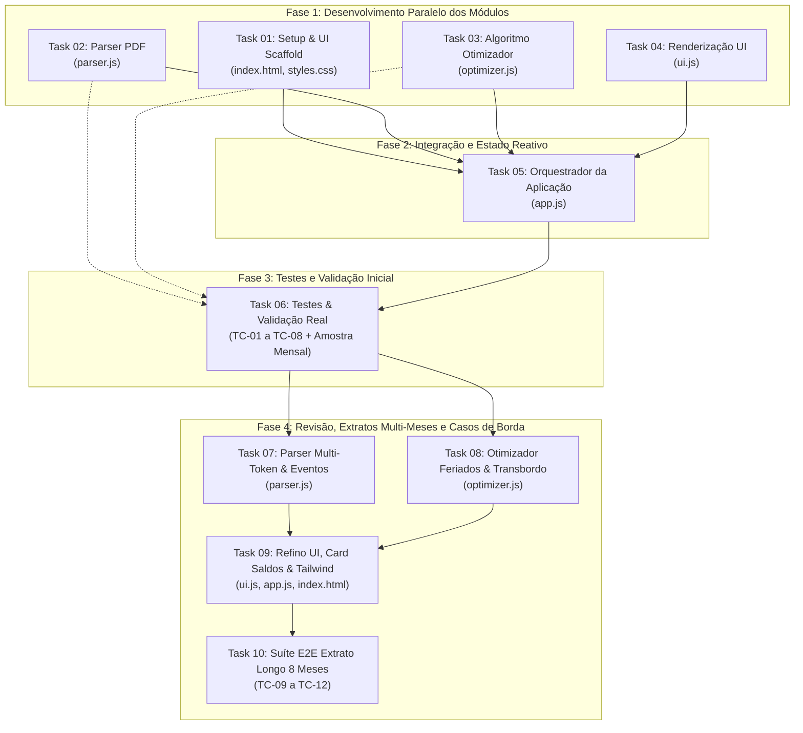

# Planejamento de Tarefas: WebApp Simplificador de Ponto por Exceção

Este diretório contém o detalhamento de todas as atividades necessárias para implementar e evoluir o sistema conforme definido em [`ESPECIFICACAO.md`](../../ESPECIFICACAO.md).

As atividades foram desenhadas para maximizar a **paralelização**, estabelecendo contratos de interface claros entre os módulos para permitir que diferentes desenvolvedores ou agentes trabalhem simultaneamente sem bloquear uns aos outros.

---

## Mapa de Tarefas

| Número | Arquivo | Título da Atividade | Status | Pré-requisitos |
|---|---|---|---|---|
| **01** | [`task-01-setup-ui-scaffold.md`](./task-01-setup-ui-scaffold.md) | Setup do Projeto e Estrutura Base HTML/CSS | ✅ Concluída | Nenhum |
| **02** | [`task-02-parser-pdf.md`](./task-02-parser-pdf.md) | Parser e Normalizador do Extrato PDF (pdf.js) | ✅ Concluída | Contrato de dados (Cap. 4) |
| **03** | [`task-03-algoritmo-optimizer.md`](./task-03-algoritmo-optimizer.md) | Algoritmo de Otimização e Pool de Horas | ✅ Concluída | Contrato de dados (Cap. 4 e 5) |
| **04** | [`task-04-componentes-ui.md`](./task-04-componentes-ui.md) | Renderização de Interface, Tabela e Clipboard | ✅ Concluída | Contrato de dados (Cap. 4, 5 e 6) |
| **05** | [`task-05-orquestracao-app.md`](./task-05-orquestracao-app.md) | Orquestração do Fluxo, Estado Reativo e Eventos | ✅ Concluída | Tasks 01, 02, 03, 04 |
| **06** | [`task-06-testes-e-validacao.md`](./task-06-testes-e-validacao.md) | Suíte de Testes e Validação com Extrato Real | ✅ Concluída | Tasks 02, 03, 05 |
| **07** | [`task-07-parser-multitoken-eventos.md`](./task-07-parser-multitoken-eventos.md) | Resiliência do Parser para Datas Multi-Token e Eventos Complexos | ✅ Concluída | Task 02 |
| **08** | [`task-08-optimizer-feriados-transbordo.md`](./task-08-optimizer-feriados-transbordo.md) | Otimizador: Feriados/Domingos Trabalhados, Piso S2 e Transbordo em Cascata | ✅ Concluída | Task 03, Contrato Task 07 |
| **09** | [`task-09-ui-tailwind-refino.md`](./task-09-ui-tailwind-refino.md) | Refinamento de UI, Card de Saldos, Cópia em Dias Extras e Tailwind | ✅ Concluída | Tasks 07, 08 |
| **10** | [`task-10-testes-extrato-longo.md`](./task-10-testes-extrato-longo.md) | Expansão da Suíte de Testes Automatizados para Extratos Multi-Meses | ✅ Concluída | Tasks 07, 08, 09 |

---

## Grafo de Execução e Dependências



---

## Contrato de Dados Compartilhado

Todas as tarefas que operam em paralelo utilizam a definição de tipos conceituais abaixo (evoluída na Fase 4 para suportar extratos multi-meses e eventos complexos):

```typescript
interface PunchRecord {
  type: 'entrada' | 'saida';
  time: string;                    // "09:10"
  minutesFromMidnight: number;     // 550
}

interface ParsedDay {
  dateStr: string;                 // "qua., 16 set. 2026" ou "dom., 08 mar. 2026"
  dateISO: string;                 // "2026-09-16"
  dayOfWeek: string;               // "qua."
  isWeekend: boolean;              // true para "sáb." ou "dom."
  punches: PunchRecord[];          // Batidas registradas no PDF
  originalBalanceMinutes: number;  // Variação em minutos (+7, -54, etc.)
  periodBalanceMinutes: number;    // Saldo acumulado do período até o dia
  bancoDeHorasMinutes: number;     // Saldo do banco de horas geral até o dia
  isSpecial: boolean;              // true para falta, feriado sem expediente ou trabalho extra em feriado/fim de semana
  specialType?: 'absence' | 'holiday' | 'extra_work' | null;
  specialReason?: string | null;   // Ex: "Falta sem abono / dia todo", "Trabalho em Feriado"
  partialHolidayNote?: string | null; // Ex: "Feriado / + 04h 45m" (em dias úteis normais)
  hasMissingPunch?: boolean;       // true quando houver "???" ou número ímpar de batidas
}

interface PeriodData {
  startDate: string;
  endDate: string;
  rawPeriodStr: string;
  days: ParsedDay[];
  totalOriginalBalanceMinutes: number; // Saldo geral do banco de horas no último dia
  bancoDeHorasMinutes: number;         // Saldo geral do banco de horas no último dia
  periodBalanceMinutes: number;        // Saldo líquido acumulado exclusivo do período do PDF
}

interface OptimizedDay extends ParsedDay {
  simplifiedAction: 'keep_standard' | 'modify_exit' | 'half_day' | 'special_action' | 'extra_work';
  adjustedBalance: number;         // Minutos atribuídos após compensação
  suggestedPunchS2?: string | null;// "16:18" ou "19:38" (null para half_day, special_action e extra_work)
  instruction: string;             // Orientação textual clara para lançamento
  reason: string;                  // Justificativa do cálculo
}
```
